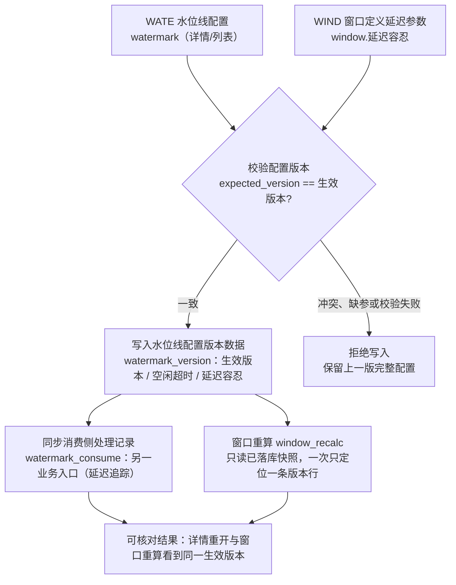

# 水位线配置版本数据链路

这份文档说明「水位线配置版本」从读取、校验、落库、同步消费到窗口重算的完整链路，
和代码里的 `GET /api/watermark/flow` 返回内容一一对应，可以照着逐环节核对。

## 1. 流程图



## 2. 六个环节

| 环节 | 数据源 | 入口 | 说明 |
| --- | --- | --- | --- |
| 1. 读取水位线配置 | `watermark` | `GET /api/watermark/{id}` | 按配置编号读取 WATE 水位线配置，详情与发布共用同一条配置。 |
| 2. 读取窗口定义延迟参数 | `window` | `GET /api/window?keyword=WIND` | 按数据流名称读取 WIND 窗口定义的延迟容忍，校验水位线是否覆盖窗口延迟。 |
| 3. 校验配置版本 | `watermark_version` | `POST /api/watermark/{id}/versions` | `expected_version` 必须等于当前生效版本；幂等键命中时直接返回已有记录。 |
| 4. 写入水位线配置版本数据 | `watermark_version` | `POST /api/watermark/{id}/versions` | 落库生效版本、空闲超时、延迟容忍以及时间字段等完整快照。 |
| 5. 同步消费侧处理记录 | `watermark_consume` | `GET /api/watermark/consumers` | 另一业务入口同步接收同一份版本数据，按版本ID去重并维护处理结果。 |
| 6. 窗口重算读取已落库快照 | `window_recalc` | `POST /api/window/{id}/recalculations` | 重算只定位一条生效版本行，空闲超时与延迟容忍取自同一行，不读详情缓存。 |

涉及的数据表：`watermark`、`window`、`watermark_version`、`watermark_consume`、`window_recalc`。

## 3. 不变量

1. **并发写入只认一个配置版本**：`expected_version` 与当前生效版本不一致即拒绝，且写入在
   `CONFIG_LOCK` 内串行化，8 个并发提交只会有一个成功。
2. **窗口重算必须读取已落库快照**：重算不读水位线详情缓存，也不从窗口定义里取延迟参数。
3. **一条重算只关联一条版本行**：`水位线版本ID` 唯一定位，空闲超时和延迟容忍来自同一行；
   指向已被取代的版本会被拒绝，不会回退到旧快照取字段。
4. **重复更新保持幂等**：发布用显式 `idempotency_key` 或「配置编号 + 基础版本 + 载荷摘要」派生键；
   重算用「窗口编号 + 版本ID + 重算区间」派生键。重复提交返回已有记录，不新增行。
5. **失败保留上一版完整配置**：所有校验在写入前完成；写入过程中的异常会回滚版本行与
   配置行，上一版的时间字段、延迟容忍、空闲超时、发射间隔、对齐策略保持原样。
6. **详情重开与重算同源**：`GET /api/watermark/{id}` 用生效版本快照回填配置行，并返回
   `当前生效版本`、`版本列表`、`消费记录` 和 `版本一致性`。

## 4. 接口清单

| 方法 | 路径 | 用途 |
| --- | --- | --- |
| GET | `/api/watermark/{id}` | 配置详情 + 当前生效版本 + 版本列表 + 消费记录 |
| GET | `/api/watermark/{id}/versions` | 单条配置的全部版本快照 |
| GET | `/api/watermark/versions` | 版本表分页（可按配置编号 / 状态 / 生效版本过滤） |
| GET | `/api/watermark/consumers` | 消费侧处理记录（可按配置编号 / 版本ID过滤） |
| GET | `/api/watermark/flow` | 链路环节、边、涉及表、不变量与 Mermaid 流程图 |
| POST | `/api/watermark/{id}/versions` | 校验版本后写入版本数据，同步写消费记录 |
| POST | `/api/window/{id}/recalculations` | 按已落库快照重算窗口 |

### 发布参数的 `values`

```json
{
  "expected_version": "v2",
  "延迟容忍": "12秒",
  "空闲超时": "50秒",
  "发射间隔": "200毫秒",
  "对齐策略": "按分区对齐",
  "idempotency_key": "publish-WATE-0002-once"
}
```

`expected_version` 必填；`延迟容忍`、`空闲超时` 只提交需要变更的字段，其余字段沿用当前配置。
`idempotency_key` 与 `remark` 二者取其一即可。

### 重算参数的 `values`

```json
{ "config_no": "WATE-0002", "version": "v2", "window_start": "10:00", "window_end": "10:01" }
```

* `config_no`：同一条数据流存在多条水位线配置时必填；
* `version` / `version_id`：可选，必须与已落库的生效快照一致，否则 `ok=false`；
* 不传版本时自动定位当前生效版本。

## 5. 验收样例

| 样例 | 期望 |
| --- | --- |
| `WATE-0002` 详情 | `生效版本=v2`、`时间字段=event_time`、`延迟容忍=10秒`、`空闲超时=45秒`、`水位线版本ID=WV-0002` |
| `WIND-0002`（60秒滑动窗口）重算 | 看到同一个 `v2` 快照，`延迟容忍=10秒`、`空闲超时=45秒`、`快照来源=watermark_version#WV-0002` |
| `WATE-0001` | 保持 `v1`，`延迟容忍=5秒`、`空闲超时=30秒`，版本列表只有一条 |

> 注意：WATE-0001（库存变更流）与 WIND-0001 是同一条流；WIND-0002 属于订单明细流，
> 因此重算 WIND-0002 只会定位到 WATE-0002 的版本，不会串到 WATE-0001。

## 6. 本地核对

```bash
cd backend
./run.sh &

curl -s 'http://127.0.0.1:8000/api/watermark/2' | python3 -m json.tool
curl -s -X POST 'http://127.0.0.1:8000/api/window/2/recalculations' \
  -H 'Content-Type: application/json' -d '{"values":{"version":"v2"}}' | python3 -m json.tool
curl -s 'http://127.0.0.1:8000/api/watermark/flow' | python3 -m json.tool
```

自动化回归：

```bash
cd backend
.venv/bin/pip install -r requirements-dev.txt
.venv/bin/python -m unittest discover -s tests -v
```
